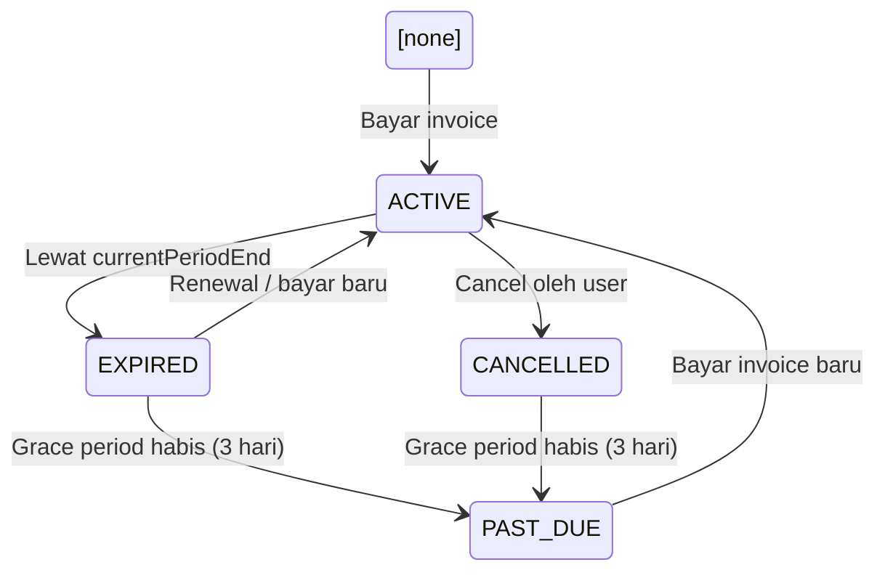
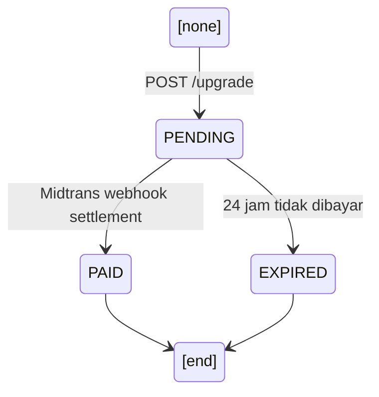

# Subscription Plans Comparison

Perbandingan fitur, limit, dan harga antar plan.

---

## Plan Matrix

| Feature                  | FREE              | STARTER              | PRO                  |
| ------------------------ | ----------------- | -------------------- | -------------------- |
| **Bot Configs**          | 1                 | 1                    | 1                    |
| **Products**             | 10                | 50                   | Unlimited            |
| **Max Broadcasts/Month** | 0                 | 50                   | Unlimited            |
| **Max Orders/Month**     | 10                | 200                  | Unlimited            |
| **Fulfillment**          | ✓                 | ✓                    | ✓                    |

**Source:** `src/services/planLimitService.js:4`

---

## Pricing

| Plan    | Monthly          | Yearly (hemat ~2 bulan) |
| ------- | ---------------- | ----------------------- |
| FREE    | Rp 0             | Rp 0                    |
| STARTER | Rp 35.000        | Rp 350.000              |
| PRO     | Rp 100.000       | Rp 1.000.000            |

**Source:** `src/services/planLimitService.js:25`

---

## Subscription Lifecycle



### Status Definitions

| Status      | Description                                      | Access     |
| ----------- | ------------------------------------------------ | ---------- |
| `ACTIVE`    | Subscription aktif, dalam masa berlaku            | Full       |
| `EXPIRED`   | Lewat `currentPeriodEnd`, masih grace period 3 hr | Full + warning header |
| `CANCELLED` | Dibatalkan oleh user, akses sampai period end     | Full       |
| `PAST_DUE`  | Grace period habis, otomatis downgrade ke FREE    | Blocked    |

### Grace Period

- **3 hari** setelah `currentPeriodEnd`.
- Selama grace period: status `EXPIRED`, akses penuh + `X-Subscription-Warning` header.
- Setelah grace period habis: status `PAST_DUE`, akses diblokir (HTTP 402), user di-downgrade ke FREE, bot config dinonaktifkan.

### Cancellation

- User cancel → status `CANCELLED`.
- Akses tetap aktif sampai `currentPeriodEnd`.
- Tidak ada refund.
- Setelah `currentPeriodEnd` + grace period → `PAST_DUE`.

---

## Invoice Lifecycle



Invoice `PENDING` otomatis expire setelah 24 jam via `expirePendingInvoices()`.

---

## Plan Enforcement

### Resource Limits

Limit ditegakkan di **route level** via middleware `planGuard.js`:

- **Bot Config:** `resource('botConfig')` — cek count vs limit setiap kali create.
- **Product:** `resource('product')` — cek count vs limit setiap kali create (`Infinity` = skip check).

### Monthly Order Limit

Dicek sebelum `saveOrder()` di:

- `orderHandler.js` (handleKonfirmasi)
- `buttonHandler.js` (handleConfirmOrder)
- `public.controller.js` (POST /api/public/order)

Jika terlampaui → customer dikirimi pesan "hubungi admin".

### Subscription Guard

`requireActiveSubscription` dipasang global di `/api/*` setelah billing routes:

- **FREE plan** → skip check.
- **PAST_DUE** → block 402.
- **EXPIRED** → allow with warning header.

---

## Harga Perhitungan (by code)

```js
PLAN_PRICES = {
  STARTER: { MONTHLY: 35000, YEARLY: 350000 },
  PRO:     { MONTHLY: 100000, YEARLY: 1000000 },
}
```

**Diskon YEARLY:** 2 bulan gratis (harga = 10 bulan, dapat 12 bulan).

---

## Invoice Number Format

```
INV-YYYYMMDD-NNNN
```

- `YYYYMMDD` = tanggal invoice dibuat.
- `NNNN` = sequence per hari (reset tiap hari).

Contoh: `INV-20250614-0001`, `INV-20250614-0002`.

`midtransOrderId` untuk subscription: `SUB-{invoiceNumber}` (prefix berbeda dari order produk biasa).

---

## Files Reference

| File                                    | Purpose                        |
| --------------------------------------- | ------------------------------ |
| `src/services/planLimitService.js`      | Definisi limit & harga per plan |
| `src/services/subscriptionService.js`   | CRUD subscription, expiry      |
| `src/services/invoiceService.js`        | CRUD invoice, Midtrans Snap    |
| `src/api/middlewares/planGuard.js`      | Middleware enforcement         |
| `src/api/controllers/subscriptionController.js` | Handler subscription API   |
| `src/api/controllers/invoiceController.js`       | Handler invoice API           |
| `src/api/routes/subscription.routes.js`          | Route definitions             |
| `src/api/routes/invoice.routes.js`               | Route definitions             |
| `prisma/schema.prisma`                  | Schema Subscription & Invoice  |
